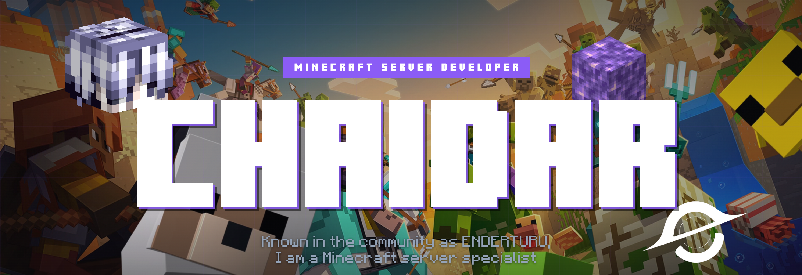

<!--
    Theme: Purple Persona (#9142ff)
    Customized for: Chaidar (NDERXZ / ENDERTURU)
    Original template credit: https://github.com/Glauedson
-->

<!-- Banner  -->

  <a href="https://github.com/NDERXZ">
     
  </a>
  <a href="https://github.com/NDERXZ/Ender-Verstappen">
     
  </a>
  <a href="https://github.com/NDERXZ/Ender-Verstappen/network/members">
     
  </a>
  

 

<!-- Who am i? -->

  

I am **Chaidar** (also known as **ENDERTURU** / **NDERXZ**), a passionate **Full-Stack Developer** focusing on **Minecraft Server Development**, **AI Integrations**, and modern **Web Development**.

My journey is fueled by **curiosity**, **engineering challenges**, and a drive to craft **high-performance systems** — from highly customized game-server infrastructure to scalable, sleek full-stack web applications. I bridge backend logic with modern, responsive front-end design to deliver intuitive and memorable user experiences.

Always building, experimenting with cutting-edge tools, and pushing boundaries to bring creative ideas to life.

 
 

<!-- badges / socials -->

  
   
   

  <!-- Portfolio -->
  
  <!-- GMail  -->
  
  <!-- Discord -->
  
  <!-- WhatsApp -->
  

 

> [!IMPORTANT]
>
> *"i am the bone of my sword, 
> steel is my body and fire is my blood, 
> i have no regrets, 
> this is the only path, 
> now whole worlds, 
> was an unlimited blade work"*
>
> Code is never finished, it only gets **better**.
>
> What you see here is forged with **passion**, **curiosity**, and **persistence**.

 

<!-- My contributions title -->

 
 

  

<table align="center">
  <tr>
    <!-- Skills Left -->
    <td valign="top" width="45%">
      
       
       
       
       
       
       
    </td>
    <!-- Highlight Project & Streak Right -->
    <td valign="top" width="55%">
      
       
       
      
    </td>
  </tr>
</table>
