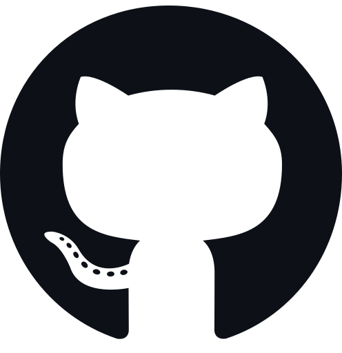
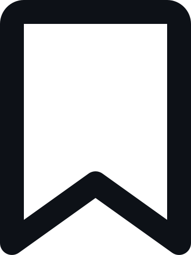

<!--
    Theme: Black & White (Minimalist / Hollow Knight)
    Customized for: Chaidar (NDERXZ / ENDERTURU)
    Original template credit: https://github.com/Glauedson
-->

<!-- Banner  -->

<!-- views/stars/followers -->
 

<a href="https://github.com/NDERXZ">
   
</a>
<a href="https://github.com/NDERXZ/Ender-Verstappen">
   
</a>

 

**Who Am I?**

I am **Chaidar** (also known as **ENDERTURU** / **NDERXZ**), a passionate **Full-Stack Developer** focusing on **Minecraft Server Development**, **AI Integrations**, and modern **Web Development**.

My journey is driven by engineering curiosity and a commitment to delivering robust, scalable systems — from intricate multiplayer game-server mechanics to responsive fullstack web applications. I bridge backend logic with creative frontend design to bring innovative ideas into functional realities.

 

<!-- A Little More About Me -->
<h3 align="center">
 
 A Little More About Me 
 
</h3>

⬛ Focus on Minecraft Server Architectures, AI tools, and Web Development. 
⬜ Experienced across TypeScript, Python, PHP, and Java ecosystems. 
⬛ Passionate about clean code, performance optimization, and scalable systems. 
⬜ Minimalist and continuous learner.

 

<!-- Connect with Me -->

 
  
  
  

 

<!-- github status-->
<h3 align="center">

 Github Status 

</h3>
 

<!-- My Tech Stack -->
<h3 align="center">
 
 My Tech Stack
 
</h3>

 

     
     
     

 

<!-- My Repositories -->

  <h3>
   
   Highlighted Repository
   
  </h3> 

  

    
  

 

  

